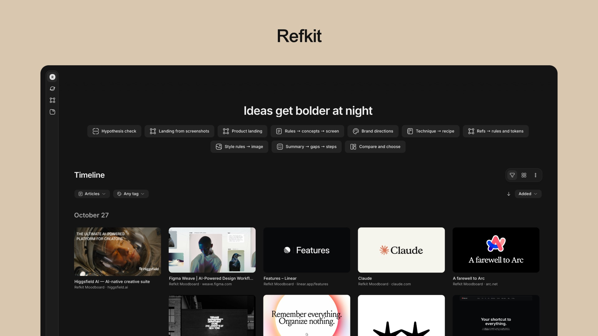
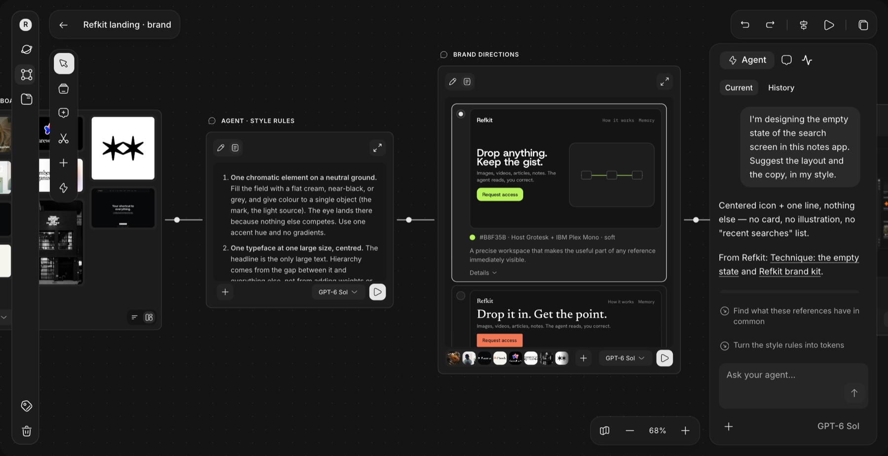

<p align="center">
  
</p>

<p align="center">
  <a href="LICENSE"></a>
  
  <a href="https://niko-myshkin.github.io/refkit/"></a>
  <a href="CONTRIBUTING.md"></a>
</p>

# Refkit

**A personal library with an agent.** [Website and interactive demo](https://niko-myshkin.github.io/refkit/). Drop in images, videos, articles, notes and links. The agent gives you the gist the way you like it, and your materials become chains on a canvas: references → style rules → brand directions → a screen, or an idea → market check → a landing page.

<p align="center">
  
</p>

> ## ⚠️ Beta
> Refkit is an early, unfinished beta that runs on your own Mac. Things will be rough. **I'm looking for honest feedback**: what worked, what confused you, what you'd use it for. Please [open a feedback issue](../../issues/new/choose) or start a [discussion](../../discussions). Thank you!

## What it does
- **One library for anything you save.** Links, images, videos, articles, notes, music. Every card keeps where it came from.
- **A canvas of connected steps.** Materials, agent steps, screens, choices. Run one step or the whole chain, pick a model per step, see every result and its versions.
- **Templates.** Brand directions from a moodboard, an idea check with market sources, a technique turned into a recipe, and more.
- **Find by meaning.** Build a concept graph over your cards and follow an idea from one card to the next.
- **Works with your agent.** A local MCP server lets Claude Code or Codex read your library, search it, and save into it. Edits are proposals you accept.
- **Memory that stays with you.** What the agent learns about how you work is stored as files in your library, not inside any one agent.
- **No autonomous background work.** Adding a material triggers a short automatic description and tags (a small model call on your subscription). Everything heavier (digests, the graph, chains, image steps) runs only when you press a button or ask your agent from Claude Code or Codex.

## Requirements
- **macOS** (some features use `sips`; Linux and Windows are not tested)
- **Node.js 20+** (developed on 22)
- **Google Chrome** installed (used headless to render screens and PDFs)
- **Claude Code and/or Codex CLI**, signed in. AI steps use your subscription; there is no API key and no cloud.
- Optional: `yt-dlp` for YouTube subtitles. Image generation currently works through Codex only.

## Quick start
```bash
git clone https://github.com/niko-myshkin/refkit.git
cd refkit/app
npm install
npm run dev
```
Open http://localhost:5173. You'll see the demo library (`library/`), so there is something to look at right away.

To keep your own materials in a separate folder:
```bash
REFKIT_LIBRARY=~/RefkitLibrary npm run dev
```

## Connect your agent (MCP)
In the app, open the agent connection and copy the ready command for Claude Code or Codex. After that your agent can search the library, follow concept links, read memory and canvases, and propose saves and edits. It cannot run nodes.

## How it works, honestly
- It's a **local web app**: a Vite dev server plus a plugin that reads and writes files in the library folder and launches your agent CLI. Not a packaged app yet.
- Your library is plain files in one folder. Local storage does not mean local AI: when you run an AI step, its prompt and inputs go to your model provider through your agent.
- The demo's saved chain results are real recorded runs; running them again uses your agent.

## Demo library
About 50 cards, a few canvases with saved results, a graph. See [`library/README.md`](library/README.md) for sources and licenses. The moodboard contains screenshots of third-party sites that belong to their authors and are not MIT-licensed; they will be removed on request.

## Security
Refkit is a local tool **without authentication**. Please read this before using it with materials you care about.
- It listens on `127.0.0.1` only and refuses to start with `--host`. Do not expose it to a network. Requests from other websites open in your browser are blocked, but any program running on your computer can use it.
- Keep it stopped when you are not using it.
- Your agent reads the text of what you save and can search the web. A saved page can contain text that tries to steer the agent (prompt injection). Keep the permissions for web search and library changes on **ask**, and be careful with untrusted pages.
- When you run an AI step, prompts and inputs go to your model provider through your own CLI. Refkit reads `~/.codex/auth.json` only so Codex can sign in; it stores no API keys.
- The server fetches links you save, so it can reach addresses on your local network. Do not save links to internal services.
- Report vulnerabilities privately, see [SECURITY.md](SECURITY.md).

## License
MIT, see [LICENSE](LICENSE). Third-party notices: [NOTICE.md](NOTICE.md).
